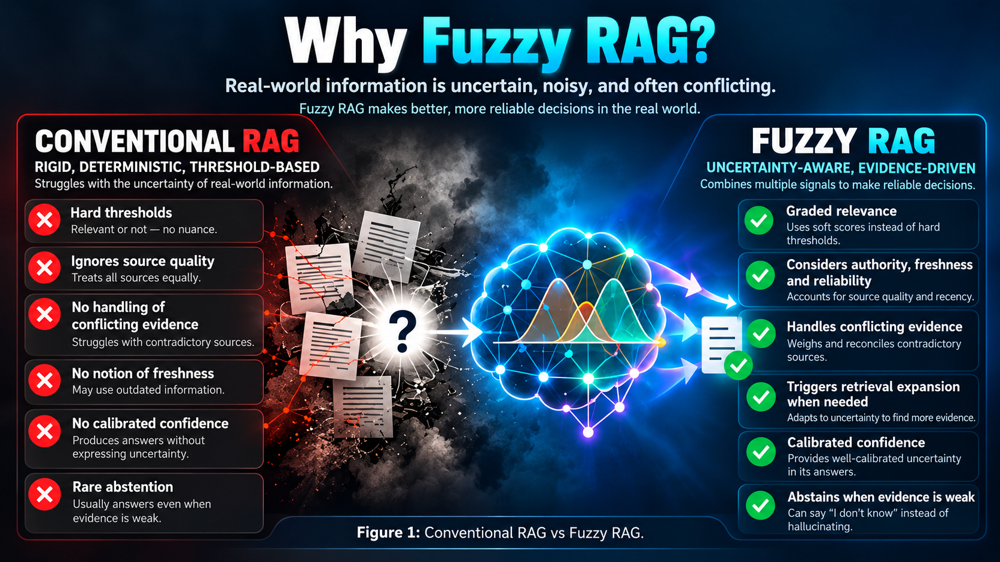
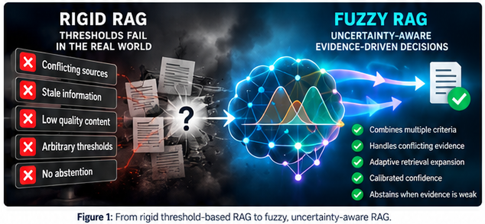
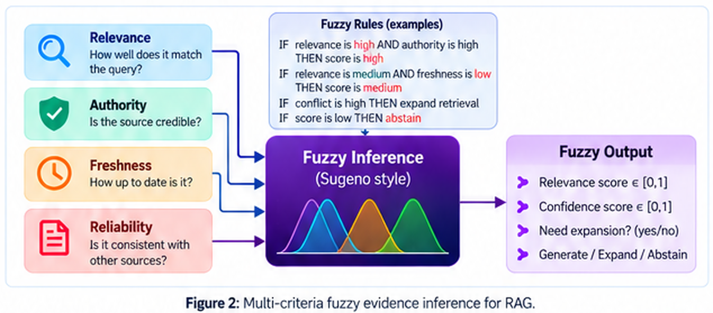
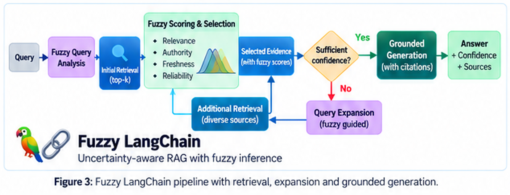
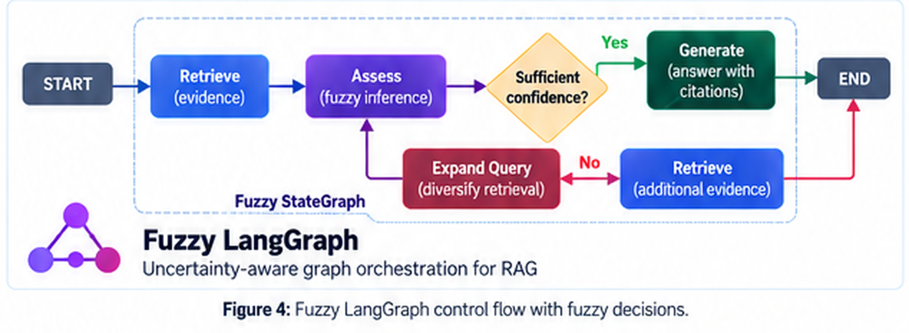
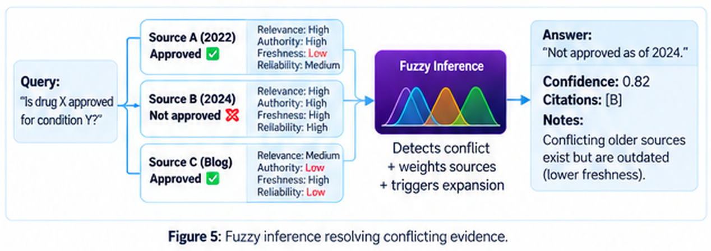
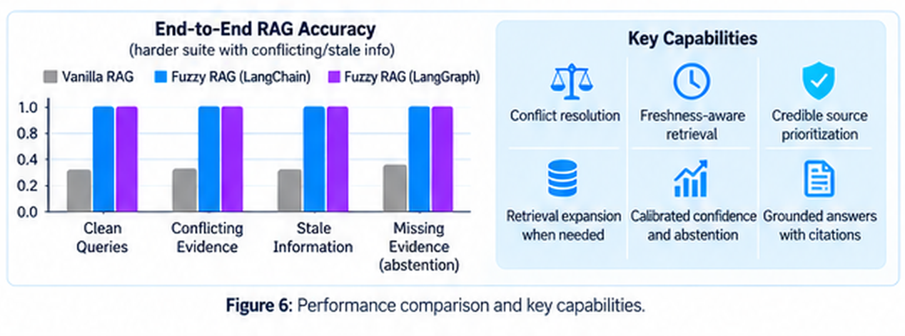

# Fuzzy Agentic Orchestration

## Agents do not live in a Boolean world. Their controllers should not either.

Most of the current excitement around agents is aimed at the visible parts: bigger models, more tools, longer context windows, more elaborate graphs, more autonomous loops.

The fragile part is usually somewhere else.

It is the control logic.

A large fraction of agentic systems still reduce their most important decisions to brittle branches:

- if confidence > threshold, answer;
- if score > threshold, call tool A;
- if retrieval fails, try tool B;
- if no result appears, stop.

This is a strange architecture for systems that operate on uncertain language, noisy retrieval, conflicting evidence, partially reliable tools, and changing information.

We are asking probabilistic, ambiguous systems to operate through Boolean plumbing.

**Fuzzy Agentic Orchestration** is an attempt to fix that layer.

RAG is the first testbed. The broader target is agentic control.

---

## 1. The orchestration layer is where uncertainty gets destroyed

Suppose an agent retrieves five documents.

One is highly relevant but old. One is recent but only partly relevant. One comes from an authoritative source but contradicts the others. Two are weaker but mutually consistent.

A conventional pipeline usually compresses this messy structure into one number per chunk, sorts the list, keeps the top few, and moves on.

The uncertainty has not been solved. It has been discarded.

The same thing happens in tool use. A planner may have several plausible next actions, each supported to a different degree. Yet the router often converts that ambiguity into one hard choice long before there is enough evidence to justify it.

That is the central failure mode: **the orchestration layer becomes more certain than the information it is orchestrating.**

Fuzzy logic gives us a way to preserve graded information instead of forcing it through premature yes/no decisions.

A source can be *mostly relevant*, *weakly authoritative*, *very fresh*, and *moderately reliable*. A tool can be *highly appropriate* but *only moderately trusted*. A route can be *promising* without being *certain*.

The controller can reason with those degrees directly.

---

## 2. Fuzziness is not vagueness. It is a control language.

“Fuzzy” is often misunderstood as imprecise or hand-wavy.

The opposite is true when it is used properly.

A fuzzy controller begins by making the criteria explicit. In the RAG implementation, each piece of retrieved evidence is assessed along four axes:

**Relevance.** Does it actually address the question?

**Authority.** Is the source credible for this claim?

**Freshness.** Is the information current enough for the query?

**Reliability.** Does it remain consistent with the stronger evidence around it?

Each signal is mapped into interpretable memberships such as LOW, MEDIUM, and HIGH. The system then applies compact rules that combine the signals.

For example:

> IF relevance is HIGH AND authority is HIGH AND freshness is HIGH, THEN support is HIGH.

> IF relevance is HIGH BUT freshness is LOW, THEN support is reduced.

> IF conflict is HIGH AND additional evidence is available, THEN expand retrieval.

> IF support remains LOW after expansion, THEN abstain.

The result is not merely a better ranking score. It is a **control decision**.

Generate. Retrieve more. Verify. Defer. Abstain.

That is why fuzzy logic belongs in orchestration rather than being treated as another post-processing trick.

It is also important to be precise about what it is not. A fuzzy confidence value is not a Bayesian posterior probability. Fuzzy logic models graded concepts and soft boundaries; Bayesian inference models uncertainty through probability. They are different tools for different structures of uncertainty.

---

## 3. RAG is only the first use case

Why start with RAG?

Because RAG exposes the control problem brutally.

The system must decide what to retrieve, what to trust, whether sources agree, whether information is stale, whether more retrieval is worth the cost, and whether an answer is justified.

Those are orchestration decisions hiding inside what is usually described as a retrieval problem.

Once the controller can reason over graded evidence, the same idea extends naturally to agents.

An agent choosing between tools can reason over:

- expected usefulness,
- tool reliability,
- latency,
- cost,
- risk,
- agreement with prior observations.

An agent deciding whether to delegate can reason over:

- task complexity,
- specialist fit,
- uncertainty,
- expected gain from another agent.

An agent deciding whether to stop can reason over:

- residual uncertainty,
- evidence coverage,
- contradiction level,
- expected value of another action.

This is the key shift:

**Fuzzy Agentic Orchestration is not about making the model fuzzy. It is about making the controller uncertainty-aware.**

---

## 4. Fuzzy LangChain: turn the chain into an adaptive process

In Fuzzy LangChain, the first retrieval is not treated as the final retrieval.

That sounds obvious, but many production RAG pipelines still effectively behave that way: retrieve once, stuff context, generate.

The fuzzy controller sits inside the loop.

The pipeline retrieves an initial candidate set, scores evidence across multiple dimensions, and asks a more useful question than “is the top similarity score high enough?”

It asks:

**Do we have enough good evidence to justify generation?**

If yes, the system proceeds to grounded generation with citations.

If not, but the evidence looks recoverable, the controller expands retrieval.

That expansion can seek more diverse sources, broaden the query, or look specifically for evidence that resolves a contradiction.

Then the evidence is assessed again.

This creates an adaptive retrieval budget. Easy queries terminate quickly. Ambiguous queries trigger extra work. Unsupported queries do not get forced into an answer.

The chain becomes conditional on evidence quality, not just on pipeline stage.

---

## 5. Fuzzy LangGraph: let uncertainty decide the next node

LangGraph makes the control idea even cleaner because the orchestration is explicit.

A graph may contain nodes such as RETRIEVE, ASSESS, EXPAND, GENERATE, VERIFY, and ABSTAIN.

The weak version of graph orchestration connects those nodes with deterministic conditions.

The stronger version allows the graph state to carry graded evidence and uses fuzzy inference to choose the next transition.

Strong evidence can produce:

**RETRIEVE → ASSESS → GENERATE**

Recoverable uncertainty can produce:

**RETRIEVE → ASSESS → EXPAND → RETRIEVE → ASSESS**

Persistent uncertainty can produce:

**RETRIEVE → ASSESS → ABSTAIN**

The graph is no longer a fixed workflow with a few thresholds.

It becomes an adaptive controller.

That matters because agentic systems are fundamentally sequential. A bad early decision does not merely lower answer quality; it changes every state that follows.

A graph that preserves uncertainty can postpone commitment, seek additional evidence, and choose a safer route when the current state is ambiguous.

---

## 6. Conflict should be a first-class state, not an inconvenience

Conflicting evidence is where simplistic RAG exposes itself.

Consider three sources:

- Source A is authoritative and relevant, but old.
- Source B is equally authoritative and newer, and directly contradicts A.
- Source C agrees with A, but is much weaker.

A similarity-only system can rank all three highly.

A generative model may then smooth the contradiction away, arbitrarily choose one side, or produce a confident synthesis that no source actually supports.

That is exactly what should *not* happen.

Conflict is information.

A fuzzy controller can represent that conflict explicitly, reduce the weight of stale or weak evidence, and decide that the correct next step is not generation but retrieval expansion.

If the additional evidence resolves the disagreement, the system can answer and cite the stronger support.

If the disagreement remains unresolved, abstention is not failure.

It is the correct action.

Agentic systems need this mindset far beyond RAG. Tool outputs can disagree. Sub-agents can disagree. Memory can conflict with new observations. External systems can be stale.

A robust controller should treat disagreement as a signal that changes the next action.

---

## 7. What the current results do — and do not — claim

The current implementation was deliberately tested on controlled RAG cases designed to expose the failure modes above: clean evidence, conflicting sources, stale information, and missing evidence.

In those tests, the fuzzy pipelines successfully used retrieval expansion, source-quality signals, freshness, conflict handling, citation grounding, and abstention to choose the correct behavior.

That is useful evidence that the architecture works as intended.

It is not a claim that fuzzy orchestration has “solved RAG” in the wild.

Real systems will require domain-specific membership functions, better source-quality estimators, learned or tuned rule bases, stronger retrievers, and much larger evaluation suites.

That is exactly where the research becomes interesting.

The point of the current release is architectural:

**do not collapse uncertainty before the controller has had a chance to reason about it.**

---

## 8. The next step is fuzzy agency, not just fuzzy retrieval

The same orchestration layer can be pushed much further.

Imagine an agent with several tools.

Instead of selecting one tool through a single classifier score, the controller can combine suitability, reliability, cost, latency, and risk.

Imagine a multi-agent system.

Instead of delegating because one route crossed a threshold, the controller can combine task fit, disagreement, expected information gain, and current confidence.

Imagine long-horizon execution.

Instead of stopping because a counter expired or continuing because a loop condition remains true, the controller can reason over residual uncertainty and the expected value of another step.

That is the larger idea behind **Fuzzy Agentic Orchestration**.

The LLM should not be the only intelligent component in the system.

The layer that decides what the LLM, retriever, tool, or agent does next should also have a principled representation of uncertainty.

RAG is simply the cleanest place to demonstrate it.

---

## Conclusion

Current agent frameworks are becoming more elaborate, but elaboration is not the same as intelligence.

A graph with fifty nodes is still brittle if every transition is driven by crude thresholds.

A chain with ten tools is still naive if it cannot represent partial confidence.

A multi-agent system is still fragile if disagreement is forced into an immediate winner.

The next generation of agentic systems needs better control semantics.

Fuzzy logic gives us one practical, interpretable way to build them.

Not because the world is vague.

Because the world is graded, conflicting, incomplete, and rarely Boolean.

And our orchestration layers should finally admit it.
